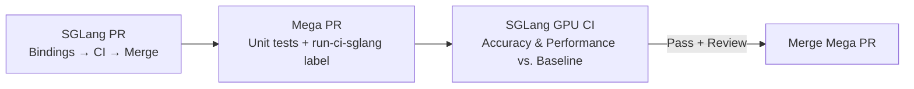

# Agent guide

This repository holds the NVIDIA megakernels of SGLang. It is an SGLang general
plugin: `sgl_nvidia_mega/plugin.py` maps each HF architecture to a spec
(`SPECS`), and SGLang imports that spec only when the server runs with
`--enable-nvidia-megakernel`. The spec admits or refuses the setup, builds the
megakernel after the model loads, and runs the steps it covers; every other
step runs SGLang's own code.

This is the guide for contributing to this repository, written for coding
agents. Read it before you edit anything. It has three parts:

1. [Dev guide](#1-dev-guide): what belongs here and how to write it.
2. [Contribution guide](#2-contribution-guide): how to submit it.
3. [CI test guide](#3-ci-test-guide): how to test it.

Terms used below: a **Mega PR** is a pull request to this repository; a
**slot** is a named place in a model's step where one of this package's kernels
replaces the stock code; **stock** code is the step as SGLang (or this package's
copy of SGLang's step) runs it without the megakernel's kernels.

[README.md](README.md) lists the supported models; each model's page in
`docs/models/` describes what its megakernel covers and how to launch it.

## 1. Dev guide

### What belongs here

The megakernels so far have needed three kinds of change:

1. **The model's forward and its kernels.** The step the megakernel takes over,
   the fused kernels it runs, and the build that prepares them.
2. **Speculative decoding.** The target-verify and draft rounds of DFlash,
   DSpark and MTP, the accept and commit steps around them, and their kernels.
3. **Small optimizations.** Improvements to the scheduler, PD disaggregation,
   HiCache, or CUDA graph capture and replay; an isolated fusion; a copy
   removed.

**Kinds 1 and 2 live in this package.** They are large, specific to one model,
and change often. Inside SGLang they would make the shared model and
speculative-decoding code hard to read, and every SGLang change would have to
keep them working. SGLang keeps only a binding to them, and the package decides
for itself what it serves:

- **The binding** is the whole interface between the two. SGLang defines the
  entry points it calls, each covering a whole phase (build, a step, a round),
  and the names of its state the package may read. The package declares which
  names it uses, and the contract tests check both sides (see
  [The SGLang contract](#the-sglang-contract)).
- **The guard** is code in this package that decides whether it serves a
  setup or a step: the spec's refusal reasons, and checks such as the K3.1 DFlash
  runtime's `_unserved`. A setup it cannot serve at all is refused at startup. A
  step it cannot serve is handed back to SGLang's own code before anything
  launches, with the reason logged (see [Where a path runs](#where-a-path-runs)).
  SGLang's DFlash binding also accepts a table of expected setup values
  (`GUARDS`); do not use it to list tested settings.

**Kind 3 goes to SGLang.** Small optimizations are usually general. Submit them
as ordinary SGLang PRs and extend them to most setups, with or without the
megakernel, instead of keeping them on the megakernel path. Turn them on wherever
they apply, not behind a switch.

This has a risk: SGLang cannot see the code behind its bindings, so an SGLang
change can break this package. We accept it to keep SGLang `main` readable; the
contract tests and E2E tests are what catch such breaks.

### Moving megakernel code out of SGLang

Kimi K3.1's DFlash round is the reference. Before it moved, about a thousand
lines of megakernel-only code sat inside SGLang's DFlash worker. The move took
two PRs, merged together:

- sgl-project/sglang#51676 deleted that code from the worker and left one
  binding module,
  `python/sglang/srt/kernel_plugins/nvidia/kimi_k31_dflash_binding.py`, with
  three entry points: the runtime's constructor (before the KV pools are
  sized), `draft_sampler` (before the draft graph is captured) and
  `decode_round`.
- #74 (brought to `main` as #77) moved the code into `kimi_k31/dflash/`.
  `decode_round` runs the whole round, or returns `None` before any launch so
  that SGLang runs its own round. The runtime declares the worker names it reads
  (`DFLASH_BINDINGS`), and lists each moved function with the digest of
  SGLang's copy (`SGLANG_MOVED`), so the two copies are checked to be the same
  for as long as some supported SGLang still has the original.
- #78 then emptied the runtime's table of tested settings (`DFLASH_GUARDS = {}`)
  and decides what it serves from what its build offers.

To move other megakernel code, follow the same steps: find the code in SGLang
that only runs with the megakernel; add a binding with whole-phase entry points
and the names it exposes, and delete the code, in an SGLang PR; move the code
here with its declarations and tests in a Mega PR; merge the SGLang PR first or
both together.

### Package layout

- One package per model, `sgl_nvidia_mega/<model>/`. It usually has `spec.py`
  (admission and build), `plan.py` (which kernel serves each row width),
  `runtime/` (the build, the executor, per-step state), step packages
  (`attention/`, `moe/`, `boundary/`, ...) and one directory per GPU
  architecture for kernels and launchers. Shared helpers go in `common/`. Models
  differ; read the model's package before assuming this layout.
- **Architecture directories do not overlap.** GB300 (SM103) kernels, launchers
  and tactics live in `sm103/`; Rubin (SM107) ones live in `sm107/`. A file in
  one directory never checks for the other architecture and never imports from
  the other directory. When SM107 needs a kernel that SM103 has, copy it into
  `sm107/` and change the copy. The duplication is intended: each architecture
  can then be tuned, rewritten or removed without touching the other. The model
  code picks the directory from the device's architecture once, at build.
  No `sm107/` directory exists yet: GLM-5.3 runs its `sm103/` kernels on
  SM107, and some Kimi K3.1 and DeepSeek-V4.1 `sm103/` files branch on SM107. Do
  not add more of this; split such code into `sm107/` when you work on it. Kimi
  K3 and K3.1 also run their `sm103/` code on SM100 (B200, GB200) today.
- Do not patch SGLang internals from this package. Hooks into SGLang's own
  forward go through SGLang's `HookRegistry`.

### The SGLang contract

The package reads SGLang by name, so an SGLang refactor can break it.
`test/unit/test_contract.py` checks every declaration below statically, against
the installed SGLang:

- A module that imports from `sglang` lists every name it reads in
  `SGLANG_READS`. An optional extension lists its names in
  `SGLANG_OPTIONAL_READS`, and its tests cover the refusal when the extension is
  absent.
- Code that mirrors an SGLang function is listed in `SGLANG_MIRRORS` with the
  digest of the SGLang code. When the digest check fails, read the SGLang change
  and update the copy before you update the digest.
- Code moved out of SGLang is listed in `SGLANG_MOVED` the same way. The check
  applies while SGLang still has the original and retires once SGLang deletes
  it.
- A DFlash runtime lists the worker names it binds in `DFLASH_BINDINGS`, which
  SGLang's binding must provide, and sets `DFLASH_GUARDS = {}`.
- CI runs these checks only against the pinned SGLang (`SGLANG_COMMIT`), and
  skips those whose SGLang side it lacks. When you change a binding that only
  SGLang `main` has, also run `test/unit/test_contract.py` against SGLang `main`.

### Where a path runs

Most optimizations work on more setups than the one they were first measured
on. Decide where a path runs from what it actually needs, written in code: the
GPU architecture, the TP size, the row counts it was built for, the cache layout
it reads. Do not restrict it to the configuration a benchmark used, and do not
copy a list of tested settings into a check. The spec's `Requirements` (GPU
architecture, TP sizes and so on) state what the kernels are built for, never a
benchmarked subset of it. Widen coverage by testing more setups (see the
[CI test guide](#3-ci-test-guide)).

When a setup cannot run a path:

- **The whole setup cannot be served:** the spec refuses it at startup and
  lists every reason. Configuration checks run before the weights load; checks
  that need the loaded model run right after it.
- **Some steps cannot be served:** hand those steps back to SGLang's own code
  before any launch, decide the same way on every rank, and log the reason once
  on TP rank 0.

Never fall back silently.

### Environment variables

The aim is that a user turns the megakernel on with `--enable-nvidia-megakernel`
and needs no other setting.

- Do not add an environment variable that would always be set the same way. If
  the new path should always run, make it the only path and delete the old one.
  If it should never run, do not merge it.
- Prefer deciding in code over adding a switch: if a path suits some setups and
  not others, check the setup (see [Where a path runs](#where-a-path-runs)).
- Remove the debug and A/B switches you used while developing before the PR
  merges. Values found by a tuning sweep become constants or per-shape tables in
  the code.
- A test hook enables test-only behavior (a parity check, fault injection);
  serving never sets it. Set it only in the tests that need it, name it with the
  `SGLANG_NVIDIA_MEGAKERNEL_` prefix, and describe it in those tests.
- If the model needs an SGLang environment variable, declare it in the spec
  (`Requirements.env`) so that startup names it when it is missing. For
  `--enable-nvidia-megakernel` to set it for the user, it must be listed in
  SGLang's `FLAG_SETS_ENV`, which is an SGLang change.
- `SGLANG_NVIDIA_MEGAKERNEL_SLOTS` replaces a model's shipped slot list, for
  tests and bisecting. In DeepSeek-V4.1-Flash, Qwen3.5 and GLM-5.3 an empty value
  runs every step's stock code. A new kernel is added as a slot that runs by
  default, not as a slot users must list.

Many existing variables are always set one way in practice, and
`SGLANG_NVIDIA_MEGAKERNEL_SLOTS` also carries some user settings (its `sm148`
entry admits 148-SM GPUs: B300, and B200/GB200 for Kimi K3 and K3.1). These are
being cleaned up; do not add more like them.

### Invariants

- **Built at load.** Buffers, kernels and tactics for every covered width are
  allocated and compiled at build time, before the KV cache is sized. Nothing is
  compiled, allocated or tuned inside a step.
- **Graph-safe decisions.** Whether a step runs the megakernel depends only on
  host state that every rank shares (forward mode, row count, batch flags). Every
  rank then decides the same way, and a captured CUDA graph replays the decision
  made at capture.
- **Fail-stop waits.** A wait on another GPU has a deadline below SGLang's
  watchdog. When it expires the rank faults; it never returns tokens from a
  failed step.
- **Declared numerics.** A path is either bitwise identical to the stock step it
  replaces, or changes the arithmetic on purpose. Say which, in the code and in
  the PR, and test it accordingly.

### Code style

- New source files start with the SPDX header used across the package.
- Comments state what the code cannot show: layouts shared with a kernel, units,
  where a constant came from. History and measurements belong in the PR.

## 2. Contribution guide

### The flow



1. **SGLang bindings, if the change needs them.** Open an SGLang PR for the
   interfaces, bindings or runtime hooks the package needs, and link it from the
   Mega PR. If SGLang `main` already has them, start with the Mega PR.
2. **Merge the SGLang PR through SGLang's own CI.** Keep it compatible with this
   repository's current `main`.
3. **Open the Mega PR against `main`** with the implementation, its unit tests
   and its E2E tests, and fill in the PR template.
4. **Run the local checks and request GPU CI.** Run `pre-commit run --all-files`
   and the unit tests. A maintainer adds the label of the model the PR changes,
   `run-ci-sglang:<model>`, which runs that model's E2E tests on SGLang's GPU CI
   (see the [CI test guide](#3-ci-test-guide)).
5. **Read the result on the Mega PR** (the `sglang-ci/megakernel` status) and
   fix what fails. A fix that belongs in SGLang goes through steps 1 and 2 again;
   a maintainer then removes and re-adds the label for a fresh run.
6. **Merge** after the required checks pass and a code owner from
   `.github/CODEOWNERS` approves. A result describes one SGLang and Mega commit
   pair; record both SHAs.

### Changes that span SGLang and this repository

- The Mega PR's GPU tests run against SGLang `main`, so its result counts only
  once the SGLang change is on `main`. When the two must land at the same time
  (as #77 with sgl-project/sglang#51676), merge the SGLang PR first and the Mega
  PR right after.
- Keep this repository's `main` working with SGLang `main` at every step. To
  replace an interface: add the new one in SGLang, move this package to it, then
  remove the old one.
- The CPU unit tests run against the SGLang commit pinned as `SGLANG_COMMIT` in
  `.github/workflows/unit-test.yml`. A read that the pinned SGLang lacks must be
  optional or skipped by name. Moving the pin is a PR of its own.
- Nightly SGLang images take this repository's `main` as of their build; SGLang
  release images record the Mega commit they were validated with. A Mega PR
  needs no Docker change.

### Branch, checks and pull request

- Work on a feature branch; `pre-commit` refuses commits on `main`. Before you
  push, run `pre-commit run --all-files` and the unit tests.
- Title the PR `[Type] scope: Title` or `[Type] [HARDWARE] scope: Title`. Type is
  one of Feat, Fix, Refactor, Perf, Doc, Test, CI or Chore; the hardware tag is
  uppercase. The `PR Title` workflow checks the format. PRs are squash-merged, so
  the title becomes the commit title on `main`.
- Fill in every section of the
  [PR template](.github/pull_request_template.md). For each affected model and
  hardware setup, give the commands, the SGLang and Mega SHAs, the model
  revision, the hardware and topology, links to the runs, and every
  measurement-only setting (for example forced speculative acceptance) next to
  the number it affects. Summarize the results in this table, and mark missing
  coverage explicitly:

  | Model / hardware / configuration | Test | Native SGLang baseline | Mega candidate | Difference / variation | Verdict and evidence |
  | --- | --- | --- | --- | --- | --- |
  | Affected case | Accuracy | Measured result | Measured result | Matched comparison | Result and link |
  | Same case | Performance | Measured result | Measured result | Relative change and noise | Result and link |

- A new model adds, in the same PR: its entries in `SPECS`, its unit tests, its
  E2E tests and its entry in `test/e2e/ci_models.yaml`, its page in
  `docs/models/` and one row in the README's supported-models table, and one
  line in `.github/CODEOWNERS` naming its owner.
- Update the model's page wherever coverage, requirements or launch commands
  change. Keep the README short: the per-model detail goes on the model's page.

### Reporting results

- Report only tests that ran, on the hardware they name. Say which cases were
  skipped or not run. Passing CPU unit tests does not qualify a change on GPUs.
- Never weaken an assertion, loosen a tolerance or change a baseline to make a
  test pass. Find the cause.

## 3. CI test guide

A change is tested by unit tests and E2E tests. (The `lint` and `PR Title`
checks must pass as well; they are not tests.)

| | Unit tests | E2E tests |
| --- | --- | --- |
| Location | `test/unit/` | `test/e2e/` |
| Runs on | this repository's CI, CPU only | SGLang's GPU CI |
| Started by | every push to a PR | a `run-ci-sglang:<model>` or `run-ci-sglang` label (see below) |
| SGLang | the pinned `SGLANG_COMMIT` | SGLang `main` |

Do not add tests under `test/kernels/`; those are legacy standalone kernel tests
outside CI. Test a kernel through the unit tests of the code around it and
through its model's E2E tests.

### Unit tests

```bash
python -m pytest test/unit -v -rfE
```

- They run without a GPU and without model weights. A case that needs CUDA must
  skip cleanly on the CPU runner; mock CUDA where the logic under test does not
  need it. To run them locally, follow the install steps in
  `.github/workflows/unit-test.yml`.
- Cover the spec's admission and each refusal reason, the plan and its widths,
  each reason a step is handed back to SGLang, and the SGLang contract. When a
  runtime orders its launches, test the order.

### E2E tests

- **Use the per-model label first.** `run-ci-sglang:<model>` runs only that
  model's E2E tests, where `<model>` is its key in `test/e2e/ci_models.yaml`
  (for example `run-ci-sglang:deepseek_v41`). Add one label for each model the
  PR changes; several model labels run those models together. `run-ci-sglang`
  runs every model, and wins when both kinds are on; keep it for changes that
  affect every model (shared code, CI). The GPU runner is shared and has a
  queue, so do not run models the PR does not touch.
- A maintainer adds the label. This repository's `run-ci-sglang.yml` then
  dispatches SGLang's `pr-test-megakernel.yml` with the PR's head SHA and the
  selected models, and reports the outcome as the `sglang-ci/megakernel` status
  on the PR. SGLang installs the PR on its current `main` and runs only
  `test/e2e/`. Record the run link and both SHAs in the PR.
- While a label stays on a PR from a branch of this repository, each push or
  reopen dispatches a new run and cancels the one in progress. A PR from a fork
  runs again only when a maintainer applies the label again.
- The model labels follow `ci_models.yaml`: when an entry is added on `main`,
  its `run-ci-sglang:<model>` label is created.
- `test/e2e/ci_models.yaml` chooses what runs. Each key is a model; `gpu` and
  `gpus` give the GPU type and the number of GPUs on one host its tests need, and
  `tests` lists its test files. A `test_*.py` file that no model lists never
  runs.
- **Today SGLang's GPU CI has only a four-GPU GB300 runner.** Every model with
  a supported setup that fits on it (TP4 or smaller on GB300) runs that setup in
  CI now. A setup that needs eight GPUs on one host or another GPU type is
  skipped with a notice; run its tests by hand (see the last item). Once an
  eight-GPU runner is added, CI will run those setups as well.
- Kimi K3's `test_kimi_k3_b300.py` adds a sequential stock/plugin accuracy and
  performance comparison on eight B300 GPUs: TP8, five-proposal/q6 DSpark,
  stock draft execution, DCP off, and the existing `sm148` opt-in. Its normal
  CI route requires SGLang's per-model runner mapping (#51429) and hybrid
  verification views (#51977) on `main`. Adding a model that fits a reviewed
  mapping needs no workflow change; adding a runner mapping does. Explicitly
  requesting an unavailable configuration must fail, not count as coverage.
- Each supported model and hardware setup needs:
  - **an accuracy test** against native SGLang with the megakernel off, on the
    same SGLang SHA and evaluation set, ending in a comparison verdict rather
    than a fixed absolute score. It uses real speculative acceptance;
  - **a performance test** against the same baseline, with repeated runs and
    their variation. Any forced acceptance is stated with the numbers;
  - and, where the model has stock step code, **a stock-parity test**: with
    every slot off, the megakernel's stock step must reproduce SGLang's
    (`test_deepseek_v41_switch.py`, `test_qwen3_5_stock_parity.py`).

  A case is one model or checkpoint, GPU, GPU count, TP/EP layout, precision,
  speculative-decoding setup and workload. A pass on GB300 does not qualify
  B300 or another GPU, and a pass at one layout does not qualify another.
  [The comparison protocol](#the-comparison-protocol) below says how to run the
  accuracy and performance tests.
- Not all existing tests meet that yet. DeepSeek-V4.1-Flash's serving test
  (`test_deepseek_v41_server.py`) launches only the megakernel and checks
  GSM8K against an absolute bound. Kimi K3's B300 test provides the paired
  comparison; other new tests follow the protocol above, and an
  agent extending an existing test moves it toward it.
- Reuse the DeepSeek-V4.1-Flash structure. A helper module
  (`deepseek_v41_server.py`) holds the model path, launch arguments and
  environment, and the `test_*.py` files launch servers with
  `sglang.test.test_utils.popen_launch_server`. For a comparison, launch the
  candidate with `--enable-nvidia-megakernel` and the baseline without it.
  `SGLANG_NVIDIA_MEGAKERNEL_E2E_URL` points the same checks at a server that is
  already running.
- A setup the CI runner cannot hold still keeps its tests in `test/e2e/`. Run
  them by hand on the hardware they name and attach the results to the PR.

### The comparison protocol

**The two arms.** The baseline is native SGLang with the megakernel off. The
candidate is the same SGLang commit with the Mega PR installed and
`--enable-nvidia-megakernel` on. Turning slots off with the plugin still enabled
is a diagnostic, not this baseline.

- Use the same hardware, model revision, tokenizer, precision, TP/EP layout,
  server settings, requests and decoding parameters in both arms, and keep the
  SGLang and Mega SHAs fixed for the whole comparison.
- Run the arms one after the other, not side by side, so they do not compete
  for GPU memory or compute.
- Check that the candidate actually runs the megakernel path under test (the
  `NVIDIA megakernel: active` log line and the path's own log lines) and that
  the baseline does not.

**Accuracy.**

- Run the same evaluation on both arms. The baseline score is the reference;
  a fixed score such as a GSM8K threshold is not.
- Choose the comparison rule for the metric and its noise before you measure
  the candidate, and make the test print a verdict, not two numbers.
- Investigate any drop; repeat matched runs to tell a regression from noise.
  Do not accept a lower score silently or change the evaluation set after
  seeing a result.
- Use real model outputs and normal speculative acceptance: no simulated
  acceptance or other performance-only settings. A bitwise parity test adds to
  task accuracy; it does not replace it.

**Performance.**

- Warm both arms up the same way, then measure the same workload. Keep
  compilation and model loading out of the steady-state numbers.
- Report the metric the change targets: tokens per second per user, total
  throughput, time to first token or inter-token latency. When the change moves
  the boundary between the megakernel and the stock path, measure on both sides
  of it.
- Repeat the measurement and report the variation with the relative change. A
  speed-up counts only if it exceeds the noise. Investigate a regression instead
  of averaging it away.
- State every measurement-only setting, such as forced acceptance, with the
  numbers. Accuracy must pass on its own, whatever the speed-up.
