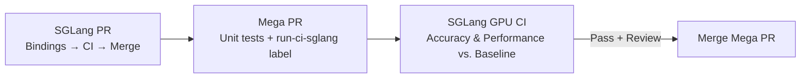

# Contributing to SGLang-NVIDIA-Mega

Changes that need new SGLang bindings land in SGLang first. The matching Mega PR
then runs against SGLang `main`, using SGLang's GPU CI infrastructure.

The contribution test suite has two layers: unit tests and end-to-end (E2E)
tests. Every supported model and hardware combination needs an accuracy E2E
test and a performance E2E test. Accuracy is assessed against a matched baseline,
not a fixed absolute score.

## Contribution flow



This diagram shows the target workflow. See [current coverage](#rollout-and-current-coverage)
for the tests already wired into CI and the remaining accuracy/performance work.

1. **Prepare the SGLang bindings, if needed.** Open a SGLang PR for framework
   interfaces, model bindings or runtime hooks that Mega needs. Link the related
   work in both repositories. If the necessary interfaces already exist on
   SGLang `main`, start with the Mega PR.
2. **Pass normal SGLang CI and merge the SGLang PR.** Keep the binding change
   compatible with the current Mega `main`. For an interface replacement, add
   the new interface first, migrate Mega, then remove the old interface in a
   follow-up. The Mega PR's integration run should use the merged bindings.
3. **Open the Mega PR against `main`.** Include the implementation, relevant unit
   tests and the affected model/hardware E2E accuracy and performance tests.
   Link the merged SGLang PR and name its commit. Use a title such as
   `[Fix] deepseek_v41: ...` or `[Perf] [GB300] deepseek_v41: ...` and complete
   the [PR template](.github/pull_request_template.md).
4. **Run local checks and request GPU CI.** Run `pre-commit run --all-files` and
   the relevant unit tests. A maintainer adds `run-ci-sglang` to the **Mega PR**.
   This dispatches SGLang's `pr-test-megakernel.yml` with the Mega PR number,
   head repository, full head SHA and a unique dispatch ID.
5. **Inspect the results on the Mega PR.** SGLang installs the selected Mega
   commit and runs the configured E2E tests on the appropriate GPU runners.
   The `sglang-ci/megakernel` commit status links to that run and reports its
   outcome. While the label remains present, a new push requests a new run;
   use the result for the PR's current head.
6. **Address failures and merge after review.** Fix Mega defects in the Mega PR.
   If the fix belongs in SGLang, submit it there, pass normal SGLang CI, merge it,
   then request a fresh Mega integration run. A maintainer can remove and re-add
   `run-ci-sglang` to request a fresh run after SGLang changes without a Mega
   code change. Merge the Mega PR after required checks and code-owner review.

A passing result describes one tested SGLang/Mega commit pair. Record both SHAs
in the PR's test evidence. If another change lands in SGLang while a run is in
progress, that run still describes its original pair; request another run when
the new SGLang change affects the integration.

## Ownership and execution

| Component | Location |
| --- | --- |
| Framework bindings and normal SGLang CI | `sgl-project/sglang` |
| Mega implementation, unit tests and E2E test definitions | `sgl-project/sgl-nvidia-mega` |
| Unit-test execution | Mega's own CI |
| Label trigger and commit-status reporting | Mega's `run-ci-sglang.yml` |
| GPU E2E orchestration and runners | SGLang's `pr-test-megakernel.yml` |

SGLang checks out the Mega PR at its full SHA and executes the tests from that
checkout. Review changes to the tests alongside implementation changes: the
candidate must not weaken its assertions or change its baseline to hide a
regression.

## Required tests

### Unit tests

Keep lightweight contract, configuration, shape, unsupported-input and runtime
logic checks in `test/unit/`. They run in Mega's CI without loading full model
weights. Do not rely on CPU unit-test success as GPU qualification.

```bash
python3 -m pytest test/unit -v -rfE
```

### E2E matrix: accuracy and performance

Keep the E2E test entry points in `test/e2e/`. For each supported combination of
model/checkpoint, hardware and execution configuration, provide **two distinct
tests**:

| Test | Purpose | Required evidence |
| --- | --- | --- |
| Accuracy (`acc`) | Compare task quality with the baseline | Baseline and Mega scores on the same evaluation set, their difference, and the comparison verdict |
| Performance (`perf`) | Compare serving performance with the baseline | Baseline and Mega throughput/latency, relative change, and repeated-run variation |

Name and document the two entry points so the workflow can select the relevant
pair. They may share launch/evaluation helpers. Include GPU model and count,
TP/EP layout, precision, speculative-decoding configuration and workload in the
case definition. A pass on GB300 does not qualify B300 or another GPU; a pass at
one parallel layout does not qualify another layout.

Add or extend the SGLang workflow selection when introducing a model or hardware
combination. A test file that exists but is not selected by CI is not CI coverage.
Required cases must execute: report a missing runner, model or unsupported setup
as unavailable coverage, not a successful qualification.

Independent `test/kernels/` runs are not a separate required contribution CI
stage. The target suite is unit tests plus E2E accuracy/performance tests.
Existing kernel test files are legacy coverage; retiring or moving useful
checks is separate work, and this guide does not delete them.

## Baseline and comparison protocol

The baseline is **native SGLang with Mega disabled**. The candidate is the same
SGLang revision with the Mega PR installed and `--enable-nvidia-megakernel`
enabled. Disabling Mega's individual optimization slots while leaving the
plugin enabled is a separate diagnostic, not this baseline.

Use the same physical hardware, model/checkpoint revision, tokenizer, precision,
TP/EP layout, server settings, request set and decoding parameters for both arms.
Keep the SGLang SHA and Mega candidate SHA fixed throughout the comparison.
Run the arms separately so they do not compete for GPU memory or compute. Verify
that the candidate actually activates the intended Mega path and that the
baseline does not. Record any additional differences needed by the model.

### Accuracy

Run the same accuracy workload on both arms and compare their results. Do not
use a hardcoded absolute target such as a fixed GSM8K score as the acceptance
criterion: the baseline measured for this configuration is the reference.

The test must produce a comparison verdict, not merely print two scores.
Choose and document a comparison rule appropriate to the evaluation metric and
its variability before measuring the candidate. Investigate a drop relative to
the baseline; repeat matched runs if needed to distinguish a regression from
evaluation noise. Do not silently accept a lower score or change the evaluation
set after seeing the result. This guide sets no universal numeric tolerance.

Use real model outputs and normal speculative acceptance for accuracy. Do not
enable simulated acceptance or other performance-only overrides. A bitwise
parity test can supplement task accuracy; it does not replace it.

### Performance

Warm up both arms under the same conditions, then measure the same workload.
Keep compilation and model-loading time separate from steady-state serving
measurements. Report the metric relevant to the change, such as tokens per
second per user, total throughput, time to first token or inter-token latency.
Include representative supported workloads and the fallback boundary when the
change affects which path executes.

Repeat measurements and report variation alongside the relative change. State
all measurement-only overrides explicitly. A speed claim must exceed the
observed noise; investigate regressions rather than hiding them in an aggregate.
Correctness must pass independently of any speed improvement.

## PR evidence and checklist

For each affected model/hardware case, attach commands, both source SHAs, model
revision, hardware/topology, environment settings and raw result/log links.
Summarize results with this table; mark missing coverage explicitly.

| Model / hardware / configuration | Test | Native SGLang baseline | Mega candidate | Difference / variation | Verdict and evidence |
| --- | --- | --- | --- | --- | --- |
| Affected case | Accuracy | Measured result | Measured result | Matched comparison | Result and link |
| Same case | Performance | Measured result | Measured result | Relative change and noise | Result and link |

- [ ] Required SGLang bindings passed normal SGLang CI and are merged, or no
  binding change is needed.
- [ ] Formatting/lint and relevant unit tests pass.
- [ ] Every affected supported model/hardware configuration has accuracy and
  performance E2E evidence against the matched baseline.
- [ ] The GPU workflow selects the intended cases; required cases did not skip.
- [ ] The current Mega head has the required integration result, with both
  source SHAs and the run link recorded.
- [ ] A new model has an owner in [CODEOWNERS](.github/CODEOWNERS), and the
  relevant owner reviewed the implementation and test changes.

## Rollout and current coverage

The label flow requires SGLang's workflow on `main`, the Mega trigger workflow
installed, the `run-ci-sglang` label, and the Mega repository secret
`GH_PAT_FOR_MEGAKERNEL_CI` configured by maintainers with Actions write access to
SGLang. Contributors do not need to supply a token. Model weights and suitable
GPU runner capacity must also be available.

The initial SGLang workflow introduced in
[SGLang #49642](https://github.com/sgl-project/sglang/pull/49642) selects only
DeepSeek-V4.1-Flash on four GB300 GPUs:

- `test/e2e/test_deepseek_v41_server.py`: serving accuracy.
- `test/e2e/test_deepseek_v41_switch.py`: eager stock-path numerical parity.

These are not yet an accuracy/performance pair. The initial accuracy test uses
an absolute bound; it still needs conversion to the matched-baseline protocol.
A performance E2E entry point and workflow coverage for other supported
model/hardware combinations remain to be added. The existing
[benchmark tools](benchmark/README.md) can supply measurement helpers, but are
not automatically an E2E CI gate. Mega's cross-repository trigger is introduced
in [Mega #53](https://github.com/sgl-project/sgl-nvidia-mega/pull/53).

## Docker versions

Nightly SGLang images follow Mega `main`, resolving a concrete commit for each
build. Official SGLang release images use a validated Mega commit recorded with
that SGLang release. Normal Mega contributions do not require a nightly Docker
pin-bump PR. Existing images retain the Mega revision they were built with.
